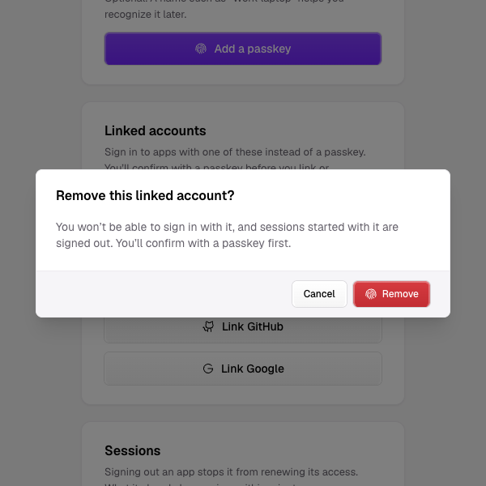

# Changelog

All notable changes to Zeabur Identity. Versions follow [Semantic Versioning](https://semver.org/); each section comes from the change files in `.changeset/` (docs/internal/releasing.md).

## 0.2.0 (2026-11-11)

### Breaking Changes

#### The server no longer has flags for key timings, metadata caching, worker threads or the key Secret's name

`--key-rotation-period`, `--key-publish-ahead`, `--key-retain-after`, `--metadata-max-age`, `--worker-threads` and `--key-secret`, and their `ZEABUR_IDENTITY_*` environment variables, are removed. The server always uses the former defaults: keys sign for 7 days, are published 24 hours ahead and kept 24 hours after, discovery documents are cached for 5 minutes, there are 2 worker threads, and the signing keys are in the Secret `zeabur-identity-signing-keys`. The server refuses to start when it is given one of the removed flags. If your deployment passes one, delete it from the Deployment's `args` and `env`; the chart sets none of them.

#### Google sign-in reads Google's endpoints from its discovery document

Before Zeabur Identity sends a user to Google, it reads `https://accounts.google.com/.well-known/openid-configuration` and then uses the sign-in, token and key addresses listed there. If your cluster limits outgoing traffic, also allow HTTPS to `accounts.google.com`, in addition to `oauth2.googleapis.com` and `www.googleapis.com`. If the document cannot be read or names a different issuer, **Continue with Google** shows an error and the server log records `provider_unavailable`. Zeabur Identity never falls back to built-in addresses.

#### The server no longer has `--store`

`--store` and `ZEABUR_IDENTITY_STORE` are removed, with the in-memory store that could not sign anyone in. The server always keeps its state in Kubernetes objects. The server refuses to start when it is given `--store`, so delete `--store kubernetes` from the Deployment's `args` if you set it; the chart does not.

#### The server no longer has `--upstream-ca-file`

`--upstream-ca-file` and `ZEABUR_IDENTITY_UPSTREAM_CA_FILE` are removed. GitHub and Google use public CAs, which the image's CA bundle already trusts. If your cluster reaches them through a proxy that re-signs TLS with its own CA, mount that CA into a directory and set both `SSL_CERT_FILE=/etc/ssl/certs/ca-certificates.crt` (the image's bundle) and `SSL_CERT_DIR=<that directory>` on the Deployment. Setting `SSL_CERT_DIR` alone replaces the image's bundle.

#### Sign-in providers are `UpstreamProvider` objects

GitHub, Google and any other OpenID provider are now `UpstreamProvider` objects in Zeabur Identity's namespace, with their client secrets in the Secret `zeabur-identity-upstream`, one key for each provider. Zeabur Identity applies a new, changed or deleted provider and a changed secret at the next sign-in, without a restart. Deleting a provider keeps its linked accounts. Any provider with the same issuer signs them in again.

The server no longer has `--github-client-id`, `--github-client-secret-file`, `--google-client-id` or `--google-client-secret-file`, or their `ZEABUR_IDENTITY_*` variables. If one is still set, the server does not start, and the log names the option and what replaces it.

To upgrade with GitHub or Google sign-in set up (the upgrade notes in "Upgrade and roll back Zeabur Identity" have the commands):

1. Save the current CRDs with the old `zeabur-identityctl crds`. A rollback needs them.
2. Apply this version's CRDs.
3. Copy each client secret into the Secret `zeabur-identity-upstream`, under the key `github` or `google`.
4. Create an `UpstreamProvider` named `github` (`type: GitHub`) or `google` (`type: OpenID`, `issuer: https://accounts.google.com`, `displayName: Google`). With these names, the callback URLs registered at GitHub and Google stay the same.
5. Regenerate the manifests with `zeabur-identityctl manifests` without the four removed options, and apply them.

When it starts, Zeabur Identity turns each linked GitHub or Google account into a `Credential` of `type: Upstream` with `provider: github` or `provider: google`. Names, owners and labels stay, so linked accounts sign in as before. A `Credential` you create for a linked account now needs `type: Upstream` and `provider`.

This change can't be undone in place: the previous version can't read `type: Upstream`, and neither version's CRD lets a credential change back. To roll back, restore the pre-upgrade backup, or, with Zeabur Identity stopped, export the `Upstream` credentials with their old type, delete them, apply the saved CRDs and create them again. Accounts linked through providers other than `github` and `google` are lost in a rollback.

### Features

#### `zeabur-identityctl client create --output json` prints the client ID, the secret and the manifest as one JSON object

A script can read the new client's secret and its `OAuthClient` from stdout in one step. A confidential client's secret is in `secret`, and the command prints nothing on stderr in this mode. A public client has no `secret` field. Without `--output json`, the command prints the `OAuthClient` as before.

#### Programs that write Zeabur Identity's objects can use the zeabur-identity-api crate

The crate holds the `identity.zeabur.com` custom resources, the API group, the labels and annotations, the admin group and `token_hash`, the stored form of invitation tokens and client secrets. Depend on it with Cargo at the tag of the release you install: `zeabur-identity-api = { git = "https://github.com/zeabur-oss/identity", tag = "vX.Y.Z" }`. Its README says which objects another program may create, change or only delete.

### Fixes

#### Sign-in buttons show each provider by its display name

The sign-in and setup pages show a **Continue with** button for each `UpstreamProvider`, under the passkey option, in the order of the provider names. A provider that is neither GitHub nor Google has a sign-in icon instead of the passkey icon. A long display name is shortened with an ellipsis and no longer makes the page wider than the screen. The same applies to the link buttons on the account page.

#### The account page no longer uses a per-session CSRF token

Changes on `/account` are refused unless the request is same-origin (`Sec-Fetch-Site: same-origin`, or an `Origin` equal to the issuer when the header is missing) and has a JSON body. A request with neither header, with `Sec-Fetch-Site: cross-site` or `same-site`, or without a JSON content type is refused as before. The `csrf` field is no longer sent or read, and the `csrf` problem type is gone.

#### Upstream sign-in refuses a return from the provider whose `iss` names another issuer

When GitHub or Google sends the browser back with an `iss` parameter, Zeabur Identity compares it with the issuer it sent the user to. If the value differs, is empty or appears twice, the sign-in or account linking ends with an error before the code is used. The audit log records `issuer_mismatch`. If `iss` is missing, sign-in and account linking work as before. A sign-in that was in progress during the upgrade ends with an error. Start it again.

#### One guide for every upstream sign-in

"Add an upstream sign-in" replaces the GitHub and Google pages. It covers GitHub, Google and any OpenID provider such as Keycloak, providers behind a private CA, changing and removing a provider, and linking an account for a user. The old addresses lead to the new page.

## 0.1.2 (2026-11-04)

### Changed

- The server image's version tag has no `v`, as with every zeabur-oss image and chart. Pull `ghcr.io/zeabur-oss/identity:0.1.2`, not `:v0.1.2`. The 0.1.1 image is also tagged `0.1.1`, and its `v0.1.1` tag stays on the same digest.
- The release file `image-digests.txt` is now `digests.txt`. Pin a deployment to its `index` line, as before. It also lists the `linux/amd64` and `linux/arm64` images ([release files](https://oss.zeabur.com/docs/identity/reference/releases/)).
- Release notes are this changelog section and a link to the documentation. The image digests are in the signed `digests.txt`.
- Zeabur Identity asks for 24Mi of memory instead of 32Mi. It used about 6Mi in a cluster with 35 pods. The limit stays at 128Mi.
- On the account page, removing a passkey, removing a linked account and renaming a passkey open a dialog instead of expanding the row. Escape or **Cancel** closes it, and focus goes back to the button that opened it.
- The sign-in pages' styles and scripts are stored and sent brotli-compressed, so a browser far away loads them in fewer round trips. A browser without brotli gets a copy decoded once.
- The sign-in pages, the docs and `zeabur-identityctl` output are reworded in English, Traditional Chinese and Simplified Chinese. Nothing they say has changed.

### Added

- Each release has `resources.json`, the total memory request of the default install (`{"requestMemoryMiB": 24}`), covered by the signed `SHA256SUMS`. An installer can read it to check a server has room before it downloads anything else. `zeabur-identityctl resources` prints the same.

### Fixed

- A passkey sign-in no longer ends on "This sign-in expired" when autofill and the **Sign in with a passkey** button both answered. Only the first answer is sent.
- Images are pushed by digest, so a release leaves no `candidate-*` tags in GHCR.

## 0.1.2-beta.1 (2026-11-03)

### Fixes

- Images are pushed by digest with no `candidate-*` tags left in GHCR

#### The sign-in pages' styles and scripts are stored brotli-compressed only

A browser that accepts brotli gets them as they are stored, and others get a copy decoded once.

#### The release file `image-digests.txt` is now `digests.txt`

It has a line per image kind (`linux/amd64`, `linux/arm64`, `index`), as in every zeabur-oss release ([release files](docs/reference/releases.mdx)). The `index` line is unchanged.

#### Release notes are the changelog section and a link to the documentation

The digests are in the signed `digests.txt`.

#### Zeabur Identity asks for 24Mi of memory instead of 32Mi

Zeabur Identity used about 6Mi in a cluster with 35 pods, so its request drops to 24Mi. The limit stays at 128Mi.

#### The server image's version tag drops the `v`

As every zeabur-oss image and chart does: `ghcr.io/zeabur-oss/identity:0.1.2`, not `:v0.1.2`. The 0.1.1 image is also tagged `0.1.1`; its `v0.1.1` tag stays and names the same digest.

## 0.1.2-beta.0 (2026-11-01)

### Fixes

- Images are pushed by digest with no `candidate-*` tags left in GHCR

#### The sign-in pages' styles and scripts are stored brotli-compressed only

A browser that accepts brotli gets them as they are stored, and others get a copy decoded once.

#### The release file `image-digests.txt` is now `digests.txt`

It has a line per image kind (`linux/amd64`, `linux/arm64`, `index`), as in every zeabur-oss release ([release files](docs/reference/releases.mdx)). The `index` line is unchanged.

#### Release notes are the changelog section and a link to the documentation

The digests are in the signed `digests.txt`.

#### The server image's version tag drops the `v`

As every zeabur-oss image and chart does: `ghcr.io/zeabur-oss/identity:0.1.2`, not `:v0.1.2`. The 0.1.1 image is also tagged `0.1.1`; its `v0.1.1` tag stays and names the same digest.

## 0.1.1 (2026-10-28)

First published alpha, for evaluating passkey-based access to self-managed Kubernetes clusters. Use a disposable cluster and keep an independent cluster-admin kubeconfig.

### Added

- Passkey enrollment and sign-in, with optional linked GitHub and Google accounts for everyday access.
- Kubernetes-backed users, credentials, invitations and grants; no separate database.
- Static Linux amd64 and arm64 CLI archives and a multi-platform server image, with signed checksums, image signatures, CycloneDX SBOMs and source/build provenance.
- Admin accounts. A `User` with `accountType: Admin` signs in with a passkey only, and its tokens carry `zeabur:admins`, bound to `cluster-admin` by the ClusterRoleBinding `zeabur-identity-cluster-admins`. `zeabur-identityctl setup-link` creates the first user as an admin account; `zeabur-identityctl invite --admin` and `zeabur-identityctl account-type <name> <admin|regular>` make or change others.
- Sessions follow NIST SP 800-63B-4: regular accounts' tokens last 10 minutes, admin accounts' 5 minutes; sessions end after 1 hour idle (15 minutes for admins with several teams or AAL3) and 12 hours after sign-in. Server options: `--refresh-idle`, `--refresh-absolute`, `--admin-token-lifetime`, `--admin-refresh-idle`.
- The ConfigMap `zeabur-identity-settings` holds install-wide settings: `teams` (`single` or `multiple`) and `admin-aal3`, which limits admin accounts to device-bound passkeys.
- Internal discovery uses cert-manager. `zeabur-identityctl kube-config` has cert-manager issue a root CA (10 years) and the internal listener's certificate (90 days, renewed automatically) in Zeabur Identity's namespace. The printed configuration changes only if the root CA or the ClusterIP changes. Without cert-manager, use `--discovery public`. The root CA's private key lives in Secret `zeabur-identity-internal-ca`: anyone who can read Secrets in Zeabur Identity's namespace can issue a certificate for the internal address.
- The account page links and unlinks GitHub or Google accounts. Both need a passkey confirmation from the last five minutes. The provider's callback links the account only to the session that started it. An account already linked to a user is refused, admin accounts cannot link, and the last way to sign in cannot be unlinked. The `User` gets `AccountLinked` or `AccountUnlinked` events.
- The setup page explains a disabled account, an expired confirmation and an already registered passkey.
- `zeabur-identityctl invite` refuses a user who already has a passkey or a linked account, as `setup-link` does. `invite --reset` deletes them, the user's sessions and pending invitations first.
- Setup links and invitations stay valid for 7 days at most (`--valid-for`).
- Issuing and redeeming a setup link or invitation each record a core `Event` on the `User` (`SetupLinkIssued`, `InvitationIssued`, `SetupLinkRedeemed`, `InvitationRedeemed`). If `zeabur-identityctl` cannot record the `Event`, it does not print the link.
- A disabled user (`spec.disabled: true`) cannot redeem a setup link or an invitation.
- A new passkey without a name shows on the account page as "Passkey added" with its creation date.

### Installation and platform scope

Follow [Get started](https://github.com/zeabur-oss/identity/blob/main/docs/get-started/quickstart.mdx) for installation and signature verification. Pin the image by the digest in the release's `image-digests.txt` asset. Signatures and build provenance name the shared release workflow of [zeabur-oss/.github](https://github.com/zeabur-oss/.github), which this repository's release workflow calls, not a workflow of zeabur-oss/identity.

| Surface | Scope | |---|---| | CLI archives and server images | Linux amd64 and arm64 | | Installation guide | Ubuntu 24.04 or later; k3s v1.36.5+k3s1 | | Automated cluster integration and E2E | k3s v1.36.5-k3s1 | | `kube-config --distro` | `k3s` on K3s/RKE2, `generic` elsewhere | | macOS, Windows and other CLI targets | No prebuilt archives; source builds are outside the release artifact matrix |

CI coverage does not establish successful installation of these release artifacts. Before making the draft public, maintainers must record clean-install, browser sign-in, permission, expiry and account-recovery results using the [release installation checklist](https://github.com/zeabur-oss/identity/blob/main/docs/internal/release-check.md) in [issue #43](https://github.com/zeabur-oss/identity/issues/43).

### Known limitations and security boundaries

- Alpha releases can break configuration and resource schemas. There are no migration, upgrade or rollback guarantees for the `v1alpha1` Kubernetes resources.
- No browser SSO sessions, RP-Initiated Logout or Back-Channel Logout. Each authorization request requires sign-in.
- DPoP is not implemented; kube-apiserver accepts bearer tokens. Zeabur Identity is not OpenID Foundation certified, and the certification suite has not been run.
- Disabling a user, resetting passkeys or revoking a grant prevents session renewal; an already issued access token remains usable until expiry, up to ten minutes with default settings.
- Keep SSH/console access, an independent cluster-admin credential and tested backups. See [operations](https://github.com/zeabur-oss/identity/blob/main/docs/operations/emergency-access.mdx).
- Only the latest published alpha is eligible for security fixes; older alphas receive no backports. See the [security policy](https://github.com/zeabur-oss/identity/blob/main/SECURITY.md).

## 0.1.0 (2026-10-28)

Withdrawn: the tag `v0.1.0` exists, but its release workflow failed and nothing was published (no GitHub release, image or signatures). Its changes are released as 0.1.1.
